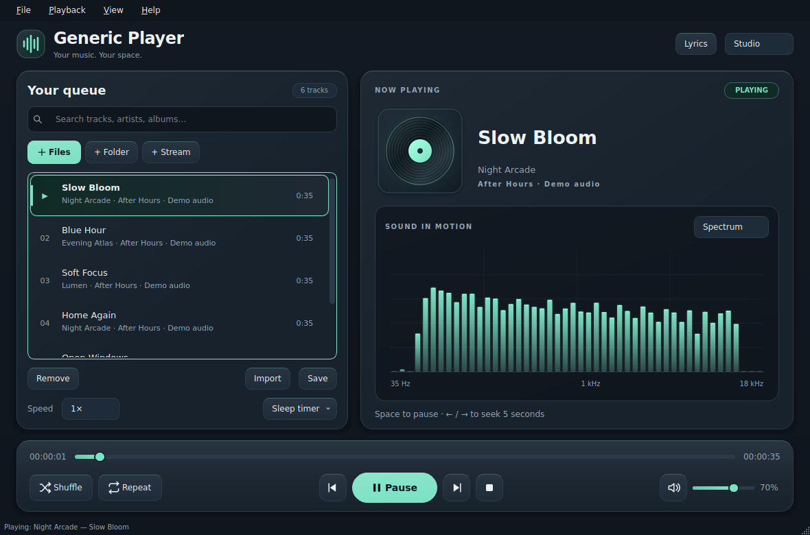
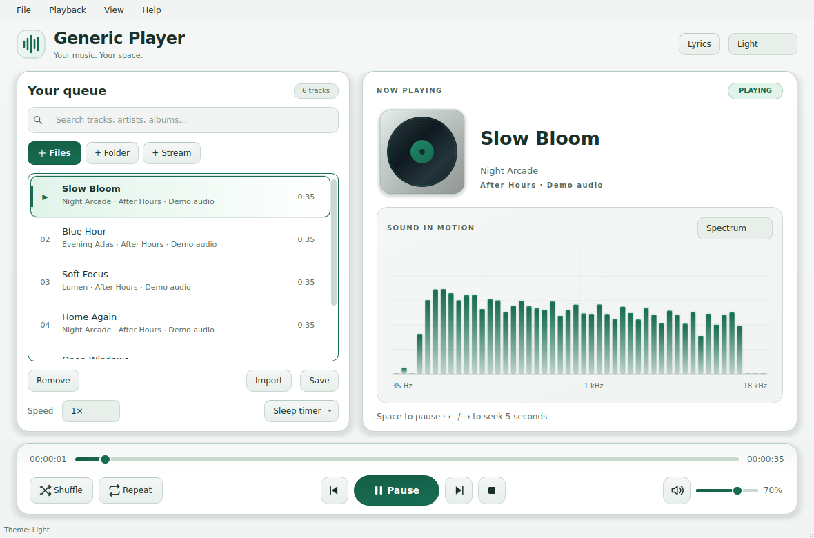
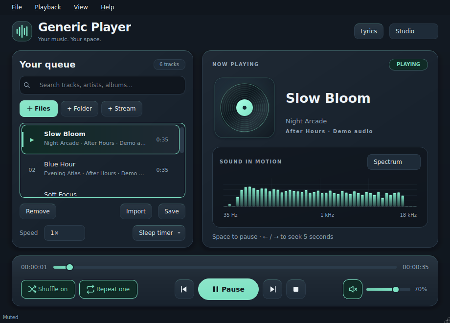

# Generic Player

**Generic Player 1.3.1** is a music and video player for Linux, built with PyQt6 and optional PyQt5 support. PyQt5 is best-effort status.

- Play local files(audio or video), folders, playlists, and internet radio.
- Search and reorder your queue; use shuffle, repeat, playback speed, and a sleep timer.
- Enjoy album artwork, lyrics, eight themes, and a visualizer driven by decoded audio.
- Restore your queue and settings without automatically starting playback.
- Control playback with **playerctl** and optionally show artist, song, and year on your desktop.



<details>
<summary>More screenshots: Light theme and compact layout</summary>

### Light theme



### Compact layout



</details>

## Get the source

Clone the project to work directly with its source:

```bash
git clone https://github.com/postman721/Generic_Player.git
cd Generic_Player
```

For a downloaded source release instead:

```bash
tar -xzf generic_player-1.3.0.tar.gz
cd generic_player-1.3.0
```

Use the downloaded file's actual name if it differs. Keep the application modules, assets, desktop data, and install helpers together.

If a copied or extracted folder gives permission errors, repair owner access **before entering it**, using its actual path:

```bash
chmod -R u+rX "$HOME/Downloads/generic_player-1.3.0"
cd "$HOME/Downloads/generic_player-1.3.0"
```

Commands below run scripts through `python3`, so scripts need read permission and folders need traversal permission. Only if you want to run `./generic_player.py` directly, also run `chmod u+x generic_player.py`. Missing dependencies require the system packages below; changing permissions does not install them.

## Install dependencies

Use **Python 3.10 or newer** and your distribution's packages. Run Generic Player as your normal user; use `sudo` only for system changes. **Wayland_OSD and other OSD software are optional.**

### Debian / Ubuntu

```bash
sudo apt-get update
sudo apt-get install \
  python3 git make \
  python3-pyqt6 python3-pyqt6.qtmultimedia libqt6multimediawidgets6 \
  python3-numpy python3-mutagen python3-requests \
  ffmpeg libavcodec-extra
```

### Arch Linux

```bash
sudo pacman -Syu --needed \
  python git make \
  python-pyqt6 qt6-multimedia qt6-multimedia-ffmpeg qt6-svg \
  python-numpy python-mutagen python-requests ffmpeg
```

This also performs a full system upgrade.

### Fedora

For conventional Fedora installations using DNF:

```bash
sudo dnf install \
  python3 git make \
  python3-pyqt6 qt6-qtmultimedia qt6-qtsvg \
  python3-numpy python3-mutagen python3-requests ffmpeg-free
```

Fedora's `ffmpeg-free` has a limited codec selection; some media may need additional codec support. Fedora Atomic host management is outside these DNF instructions.

## Run or install

Run from the source folder:

```bash
make check
python3 generic_player.py
```

Add files or drop a folder into the queue, then double-click a track or press Play. **Space** plays/pauses, **Ctrl+F** searches, and **F1** shows shortcuts. Choose Spectrum, Waveform, or Off above the visualizer.

Visualization requires **Qt6 6.8+ with the FFmpeg backend**, or a Qt5 backend with audio-probe support. Older Qt6 versions still support playback. Normal use requires a graphical desktop, working audio output, and suitable codecs. `make check` checks dependencies and optional OSD configuration in a checkout or extracted release. Its OSD checks only inspect files and configuration: they do not launch OSD commands, connect to services, or require a running session bus.

### System installation

These commands work on Debian/Ubuntu, Arch, and conventional Fedora:

```bash
sudo make install
generic-player
```

Code goes under `/opt/generic-player`, the launcher under `/usr/local/bin`, and desktop data under `/usr/local/share`. If `/usr/local/bin` is missing from your `PATH`, run `/usr/local/bin/generic-player` directly.

Keep the source folder for manual removal:

```bash
sudo make uninstall
```

The installer refuses to overwrite unowned files. Uninstall removes only unchanged owned files and preserves modified files, unrelated content, and saved settings. Use the same installation-path variables for both commands; `make help` lists them. Neither command installs or removes OSD software.

### Optional Debian package

With `dpkg-deb` available, build as your normal user:

```bash
make deb
sudo apt install ./dist/generic-player_1.3.0-1_all.deb
```

Remove it with `sudo apt remove generic-player`. Remove a previous manual installation before installing the package. Arch and Fedora use the manual commands above.

## Desktop controls with playerctl

Generic Player publishes MPRIS automatically through QtDBus when a desktop session bus is available. The `playerctl` command is an optional client; it is not needed for local playback or for another MPRIS client to control the player.

Install the client if wanted:

| Distribution | Command |
| --- | --- |
| Debian / Ubuntu | `sudo apt-get install playerctl` |
| Arch Linux | `sudo pacman -S --needed playerctl` |
| Fedora | `sudo dnf install playerctl` |

With Generic Player running in the same desktop session:

```bash
playerctl --list-all
playerctl --player=Generic_Player play
playerctl --player=Generic_Player pause
playerctl --player=Generic_Player play-pause
playerctl --player=Generic_Player stop
playerctl --player=Generic_Player next
playerctl --player=Generic_Player previous
playerctl --player=Generic_Player position 5+
playerctl --player=Generic_Player volume 0.7
playerctl --player=Generic_Player loop Playlist
playerctl --player=Generic_Player shuffle On
playerctl --player=Generic_Player metadata artist title
playerctl --player=Generic_Player metadata generic-player:year
```

Next/previous preserve paused or stopped playback when sent through MPRIS. Loop accepts `None`, `Track`, or `Playlist`; shuffle accepts `On`, `Off`, or `Toggle`. Volume ranges from `0.0` to `1.0`. Use `metadata xesam:contentCreated` for the tagged date, preserving its known precision; unavailable dates and years are omitted.

The primary service is `org.mpris.MediaPlayer2.Generic_Player`. Additional instances use `.instance<PID>`; select the full name shown by `playerctl --list-all` when targeting a particular window. `playerctl --player=Generic_Player --follow metadata` lets compatible tools observe metadata changes.

## Optional song notifications

Choose **View → Song notifications**. **Automatic** is the default for new preferences; an existing saved choice, including **Off**, is preserved. If you previously used Off, select Automatic to enable discovery. Song changes and play/pause/stop updates show the artist, title, known year, and playback status. Playback and playerctl work even when no OSD is available.

| Installed service or tool | Discovery and support |
| --- | --- |
| GNOME Shell or KDE Plasma desktop notifications | Automatic detects the active `org.freedesktop.Notifications` service. **Desktop notifications (GNOME / KDE)** selects it directly. |
| dunst, swaync, or another compatible notification daemon | The same public notification service is detected automatically, independent of the desktop name. |
| `osd`, `wayland-osd`, `wayland_osd`, `wayland-volume-osd` | Compatible [Wayland_OSD](https://github.com/postman721/Wayland_OSD) sockets and installed clients are detected automatically. **Wayland OSD** selects this integration directly. Names alone do not establish compatibility. |
| A custom daemon using Wayland_OSD's JSON socket protocol | Set `GENERIC_PLAYER_OSD_SOCKET` to its existing socket; Automatic and Wayland OSD use that endpoint. |
| A custom command with another interface | Set `GENERIC_PLAYER_OSD_ARGV` as described below; Automatic and **Custom command** use this adapter. An unknown command's arguments cannot be discovered from its filename. |

Automatic gives priority to an explicit custom argument array, then an explicit socket or compatible-command override. Without overrides, it tries a running compatible Wayland socket, an active desktop notification service, and finally a verified installed Wayland client. An invalid explicit override is reported without silently sending the notification through another service. Use **Off** to disable all delivery.

**Desktop notifications request five seconds (5000 ms).** The desktop controls the actual duration, appearance, and Do Not Disturb policy. GNOME/KDE support here uses their public notification popups. Their private volume/brightness overlays have different access and timing rules and are not the interface used for song cards. See the [desktop notification protocol](https://specifications.freedesktop.org/notification/latest-single/) for the service contract.

### Locate and start Wayland_OSD

Generic Player first tries compatible, user-owned sockets in `XDG_RUNTIME_DIR`, `/run/user/<uid>`, and the legacy `/tmp/wayland-volume-osd-<uid>` directory. Renaming the upstream executable to `osd` leaves its socket name as `wayland-volume-osd.sock`.

Client discovery checks `osd`, `wayland-osd`, `wayland_osd`, and `wayland-volume-osd` in `/usr/bin`, `/usr/local/bin`, and `PATH`. Before starting a client, Generic Player checks its `--help` output for the supported interface and skips incompatible candidates. A compatible client's normal media command can start its shared daemon when needed; its initial artist/title card may appear briefly before the complete artist/title/year card replaces it. Generic Player does not install OSD packages or change their configuration.

For your installation, these commands inspect the client and open its settings:

```bash
/usr/bin/osd --help
/usr/bin/osd setup
```

A newly started compatible daemon receives a **5000 ms** timeout. An already-running daemon keeps its current timeout: set **Hide timeout (ms)** to **5000** in its setup window for five-second cards. That setting applies to **all cards from the daemon**, including volume cards. Use your executable's actual name for setup, for example `wayland-osd setup`, `wayland_osd setup`, or `wayland-volume-osd setup`.

After installing or starting the OSD, choose **View → Song notifications → Retry current song notification** to retry the current song without changing tracks. Reselecting the active notification mode also retries. Error messages distinguish an unavailable command, an incompatible client, and a socket/startup failure.

### Custom locations and commands

Set an override before starting Generic Player when your desktop has a restricted `PATH` or the executable is elsewhere:

```bash
GENERIC_PLAYER_OSD_COMMAND=/usr/bin/osd python3 generic_player.py
```

`GENERIC_PLAYER_OSD_COMMAND` must be one absolute executable path to a compatible Wayland client, with no shell arguments. Quote a path containing spaces. For a custom running daemon, `GENERIC_PLAYER_OSD_SOCKET` accepts one absolute path to a user-owned socket implementing the same newline-delimited JSON protocol. This socket override connects only to that existing daemon and disables automatic startup. Start the daemon separately before retrying.

The compatible socket receives one UTF-8 JSON object followed by a newline, for example:

```json
{"type":"show","mode":"media","title":"Playing","detail":"Artist — Song (2026)","level":100}
```

`title` is the playback status; `detail` contains the song text. Paused/stopped cards use level `0`. The daemon controls when the card disappears.

For a tool with another command-line interface, declare its argument array. For example, if `notify-send` is already installed:

```bash
GENERIC_PLAYER_OSD_ARGV='["notify-send","--expire-time={timeout_ms}","--app-name=Generic Player","--","{status}","{text}"]' python3 generic_player.py
```

The first item is a literal executable name on `PATH` or an absolute path, including spaces if needed. Each following item is one argument. Adapt the arguments to your tool's documented interface. Available fields are `{artist}`, `{title}`, `{album}`, `{year}`, `{status}`, `{text}` (artist, title, and known year), and `{timeout_ms}` (`5000`). Missing artist, album, and year fields are empty. Use `{{` and `}}` for literal braces in arguments. Shell expansion, pipes, redirection, and command substitution are not evaluated.

For example, a tool installed at a path with spaces could use this array. Replace the path and flags with its actual interface; `{{Music}}` becomes the literal argument `{Music}`:

```json
["/home/alex/bin/My OSD","--message","{text}","--timeout","{timeout_ms}","--label","{{Music}}"]
```

The array accepts 1–32 strings, each at most 4096 characters, with up to 32768 characters of configuration. Invalid JSON, unsupported fields, or an unavailable executable are reported. Custom command mode requires this variable; selecting the mode alone does not invent an adapter. Empty overrides are invalid; unset a variable to restore automatic discovery. The custom program controls its own display duration. Choose a command that sends its card and exits within three seconds; the player stops commands that exceed that deadline. The built-in Desktop notifications mode does not need `notify-send` or another command installed.

Current Wayland_OSD offers no per-card timeout override. Its built-in media commands do not watch song changes and omit the year; Generic Player supplies the complete text over the socket. Bind media keys directly to the `playerctl --player=Generic_Player` commands above: Wayland_OSD's own media-key wrappers can replace that card with their artist/title-only text.

Other MPRIS listeners can use Generic Player's metadata and state signals independently of these notification modes. If an OSD is absent or cannot start, local playback continues normally. Turning notifications Off cancels the player's pending delivery work; a shared OSD daemon started by its normal client can remain available to other applications.

## Keyboard shortcuts

| Shortcut | Action |
| --- | --- |
| P / Space / Alt+P | Play or pause |
| Ctrl+Left / Ctrl+Right | Previous / next |
| Left / Right | Seek five seconds |
| M / S / R | Mute / shuffle / repeat mode |
| Ctrl+O / Ctrl+Shift+O | Add files / folder |
| Ctrl+I / Ctrl+S | Import / save playlist |
| Ctrl+F | Search queue |
| Esc in queue search | Clear the filter and return focus to the queue |
| Enter / Delete in queue | Play / remove selection |
| Enter on a focused button | Activate that button |
| Ctrl+L | Toggle lyrics |
| F11 / Esc | Fullscreen / return |
| F1 | Show shortcuts |
| Ctrl+Q | Quit |

P, Space, M, S, and R control playback while the player, a button, a closed noneditable selector, or read-only lyrics has focus. Text editors, editable selectors, dialogs, and open menus retain their normal keys. Arrow keys keep their normal behavior in selectors, sliders, and text views. Fullscreen moves focus to the media view and restores the previous control when you return.

Author/Copyright: **JJ Posti**, [techtimejourney.net](https://www.techtimejourney.net/). 2026.
Licensed under GPLv2 or later.
